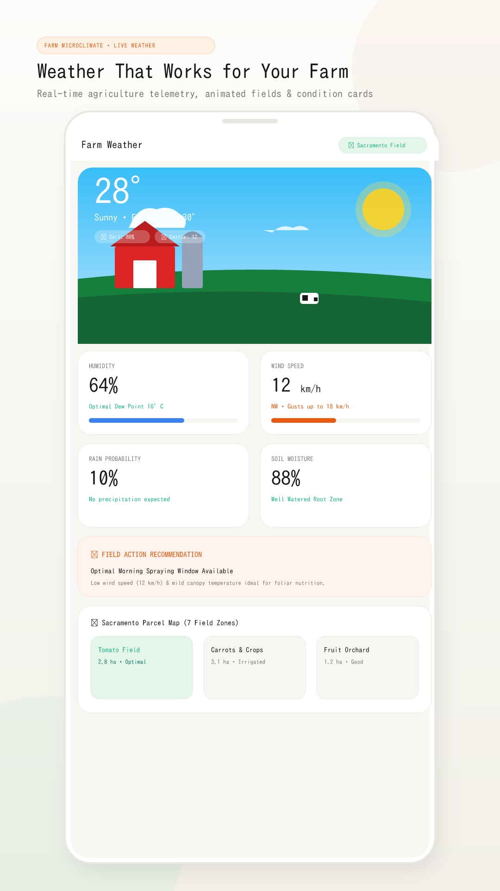
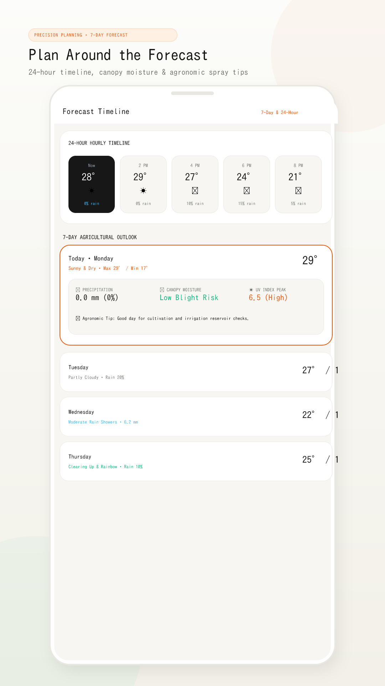
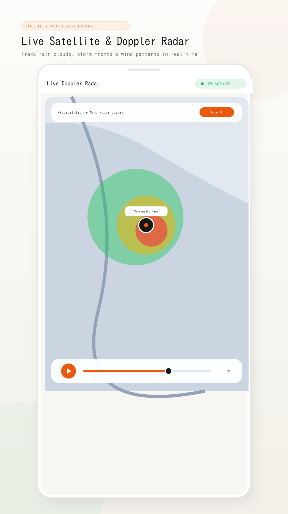
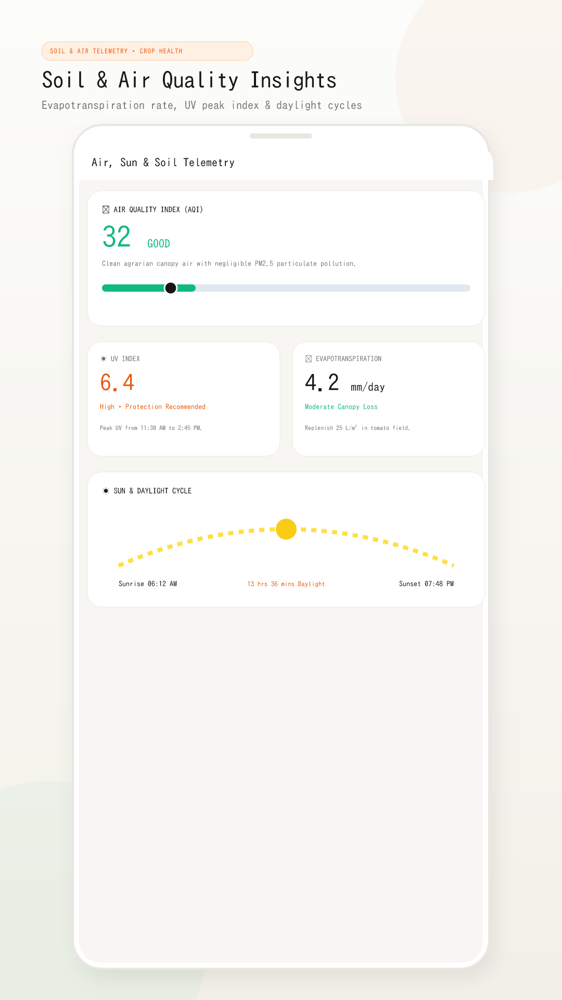
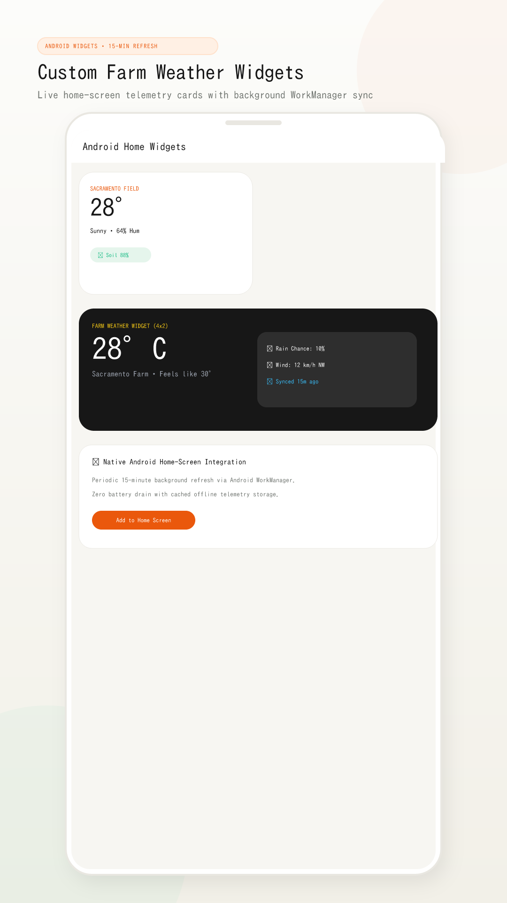
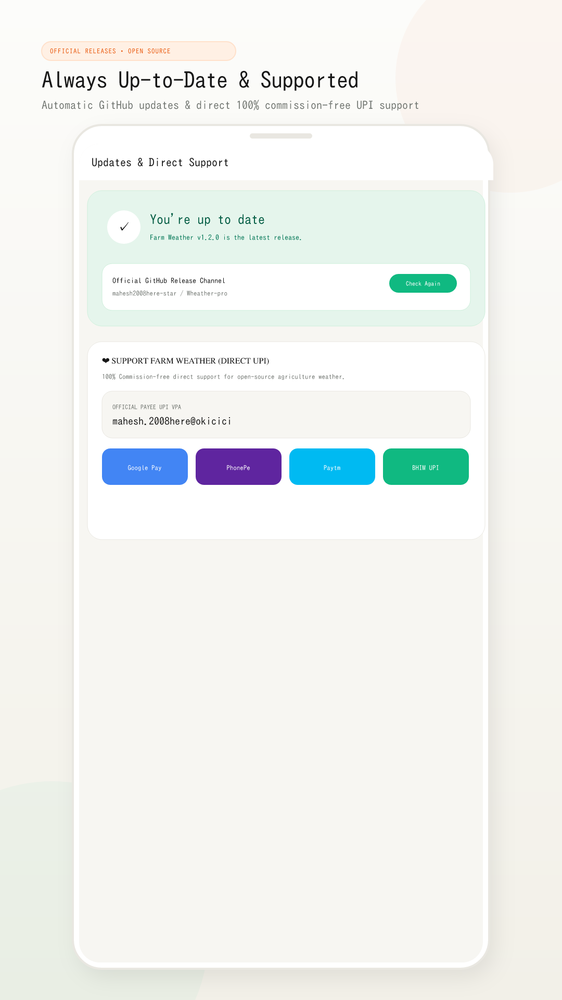

<div align="center">
  
  <h1>Farm Weather — Smart Agriculture & Microclimate</h1>
  <p><strong>Premium Android Agriculture Weather Application with Material Colors, Live Satellite Radar, Home Screen Widgets & 15-Minute Sync</strong></p>
</div>

---

## 📸 Google Play Store Screenshots Showcase

<div align="center">
  <table border="0">
    <tr>
      <td align="center" width="33%">
        <strong>🌾 Weather That Works for Your Farm</strong><br/><br/>
        
      </td>
      <td align="center" width="33%">
        <strong>📅 Plan Around the Forecast</strong><br/><br/>
        
      </td>
      <td align="center" width="33%">
        <strong>🛰️ Live Satellite & Doppler Radar</strong><br/><br/>
        
      </td>
    </tr>
    <tr>
      <td align="center" width="33%">
        <strong>🌱 Soil & Air Quality Telemetry</strong><br/><br/>
        
      </td>
      <td align="center" width="33%">
        <strong>📱 Native Home Screen Widgets</strong><br/><br/>
        
      </td>
      <td align="center" width="33%">
        <strong>🔄 App Updates & Direct Support</strong><br/><br/>
        
      </td>
    </tr>
  </table>
</div>

---

# Farm Weather - Smart Agricultural Microclimate App

Official production repository for **Farm Weather**, built for farmers, agronomists, and weather enthusiasts.

---

## 🌟 Core Features

### 1. Animated Farm Microclimate Engine
- **Dynamic Microclimate Hero**: Responsive animated SVG field landscape reflecting real-time weather conditions (Sunny, Cloud cover, High Wind, Rain, Rainbow clearing).
- **Farm Parcel Telemetry**:
  - Classic red wood-paneled barn with weather vane and silo.
  - Wind turbine speed synchronized with real-time wind metrics.
  - Furrowed field soil, livestock indicators, and live canopy moisture badges.

### 2. Comprehensive Agricultural Telemetry
- **Temperature & Feels-Like**: High precision telemetry with dew point calculations.
- **Humidity & Evapotranspiration**: Soil canopy moisture and blight/fungal risk index.
- **Wind Speed & Direction**: Real-time wind gust ratings and pesticide spray advisories.
- **Precipitation Probability & Accumulation**: Next-hour rain charts and volume estimates.
- **Soil Moisture & Temperature**: Deep-layer soil saturation and root zone health.
- **Solar Radiation & UV Index**: Direct PAR radiation and UV peak advisories.

### 3. Interactive Farm Parcel Map (7 Zones)
- Interactive isometric parcel map with zone telemetry:
  - **Farm House**: Homestead & telemetry station (1.2 ha).
  - **Tomato Field**: Roma & San Marzano with fruit ripening telemetry (2.8 ha).
  - **Vegetables**: Lettuce & carrot rows (3.1 ha).
  - **Fruit Orchard**: Apple & pear trees (1.2 ha).
  - **Pasture & Livestock**: 48 head of dairy cattle and sheep (3.4 ha).
  - **Water Storage Pond**: Retention reservoir with 9,200 L reserve (0.8 ha).
  - **Overview**: 12.5 ha total property telemetry.
- Tap any parcel to highlight and inspect soil moisture, irrigation status, and crop health notes.

### 4. 7-Day & Hourly Forecast
- Hourly horizontal timeline for 24-hour weather tracking.
- **Interactive Expandable Daily Forecast Items**:
  - Tapping any forecast day smoothly expands an agricultural breakdown drawer.
  - **💧 Precipitation Breakdown**: Expected volume (mm), rain probability gauge (%), and precipitation duration window (~hrs).
  - **💦 Humidity Levels & Microclimate**: Relative humidity %, canopy moisture status, and leaf transpiration risk indicator (e.g. blight/mildew monitoring).
  - **💨 Wind & UV Peak Metrics**: Max gust speeds and peak UV ratings.
  - Contextual agronomic field tips tailored to each day's forecast (e.g. skip irrigation recommendations, foliar spray windows).

### 5. Actionable Farm Recommendations
- **Watering Recommended**: Schedule early morning drip cycle to reduce evaporation by 30%.
- **Rain Expected**: Skip automated irrigation and save reservoir reserves.
- **Good Planting Conditions**: Recommended seeding for lettuce and carrots.
- Interactive modal confirmation for all farming actions.

### 6. Real-Time Severe Weather Alert Notification System
- **Automatic Multi-Hazard Detection**:
  - ❄️ **Frost & Freeze Advisory**: Triggered when temperatures drop $\le 3^\circ\text{C}$ with frost formation on tender foliage. Actions include activating overhead micro-sprinklers or deploying protective row fleece over Tomato and Vegetable zones.
  - 💨 **High Wind & Gale Warning**: Triggered when wind gusts reach $\ge 32\text{ km/h}$ (such as in the video's "Wind picking up" state with 36 km/h gusts). Actions include pausing pesticide spraying/boom irrigation and securing greenhouse polytunnel vents.
  - 🌧️ **Heavy Downpour & Drainage Advisory**: Triggered during intense rainfall accumulation ($\ge 6\text{ mm}$), alerting to inspect reservoir weir gates and clearing drainage channels.
  - ⚡ **Severe Thunderstorm Warning**: Triggered on active lightning codes (`95`, `96`, `99`), alerting to shelter livestock.
- **Prominent Banner on Home Screen**:
  - Live pulsing status indicator (`● WARNING` / `● ADVISORY`).
  - Diagnostic metric readout and specific parcels at risk (e.g. *Tomato Field*, *Vegetables*, *Pasture*).
  - One-tap actionable mitigation button directly on the banner with toast confirmation.
  - Expandable "Advisory Protocol" modal detailing complete agronomic protective measures.
  - Dismissible with quick simulation shortcuts (`Test Frost`, `Test Wind`) to easily preview and verify alerts.
  - Synchronized header warning badge showing total active alarms.

### 7. Free Weather API Integration (Open-Meteo)
- **Provider**: Open-Meteo (open-source, free non-commercial tier, zero API key required).
- **Endpoints**:
  - Forecast: `https://api.open-meteo.com/v1/forecast`
  - Geocoding: `https://geocoding-api.open-meteo.com/v1/search`
- **Real Geocoding**: Search any city or agricultural region globally.
- **Safe Fallback**: Retains offline agronomic state matching video presets if network is unavailable.

### 7. Dark Mode Theme (User Requested)
- **Palette**:
  - **Light Theme**: Warm cream background (`#F9F7F2`), crisp white cards (`#FFFFFF`), deep stone text (`#1C1917`), lush green accents (`#15803D`).
  - **Dark Theme**: Agrarian night slate (`#0F172A`), rich card surfaces (`#1E293B`), luminous slate typography (`#F8FAFC`), glowing stars and crescent moon, glowing barn windows.
- Accessible via quick toggle in the top bar and in the Settings / Profile screen.
- Persisted to browser `localStorage`.

### 8. Pure Flutter & Dart Codebase
- Built-in source code viewer and exporter in the Profile tab containing:
  - `pubspec.yaml`
  - `lib/main.dart`
  - `lib/screens/weather_home_screen.dart`
  - `lib/widgets/animated_farm_scene.dart`
  - `lib/theme/app_theme.dart`

---

## 📱 How to Get the Android APK from GitHub

### Why wasn't the APK showing before?
When you push code to GitHub, GitHub acts as a code repository. It does not automatically compile web or mobile code into a `.apk` file unless an automated **GitHub Actions CI/CD workflow** is configured.

### ✅ Automated GitHub Actions Pipeline is Now Configured!
We added `.github/workflows/build-apk.yml` and initialized **Capacitor Android** in the repository.

#### Method 1: Download the APK from GitHub Actions
1. In your GitHub repository, click on the **Actions** tab at the top.
2. Select the workflow titled **"Build & Release Android APK"**.
3. If the previous run failed (Red X), click on that run, then click **"Re-run all jobs"** (top right), or push a new commit to trigger the fixed workflow.
4. Once completed (Green checkmark), scroll down to **Artifacts** at the bottom of the page.
5. Click **`WeatherApp-Android-APK`** to download your APK!

#### Method 2: Automatic GitHub Release (APK Attached to Assets)
The workflow now automatically creates and updates a release with the APK:
1. On your GitHub repo page, click **Releases** (on the right sidebar).
2. Under the **"Latest Android APK Release"**, look under **Assets**.
3. Click **`WeatherApp-release.apk`** to download and install immediately on your Android phone!

#### 🔧 What Was Fixed for the Red X Build Failure:
- **Dependency Resolution (`ERESOLVE`)**: Removed root `esbuild` version conflict with Vite 8 and added `--legacy-peer-deps` so `npm install` passes smoothly in CI.
- **Java 21 Requirement**: Upgraded JDK from 17 to Java 21 (Temurin) to support Capacitor 8 and Android Gradle Plugin 8.13+.
- **Automated Platform Provisioning**: Added automatic fallback detection to initialize Android assets if not already cloned.

#### Method 3: Build the APK Locally on Your Computer
If you have Node.js and Java / Android Studio installed:
```bash
# 1. Install dependencies
npm install

# 2. Build web bundle and sync to Android project
npm run build:android

# 3. Build the APK using Gradle
cd android
./gradlew assembleDebug
```
The compiled APK will be located at:
`android/app/build/outputs/apk/debug/app-debug.apk`

Or open in Android Studio:
```bash
npx cap open android
```
Then select **Build > Build Bundle(s) / APK(s) > Build APK(s)**.

---

## 🚀 Running the Project

```bash
# Install dependencies
npm install

# Start Vite development server
npm run dev
```

Build for production:
```bash
npm run build
```
